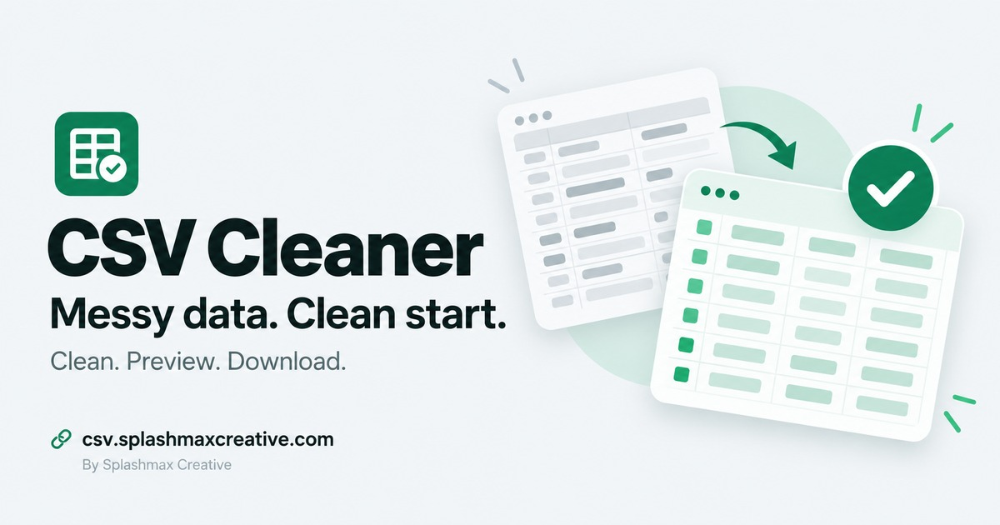
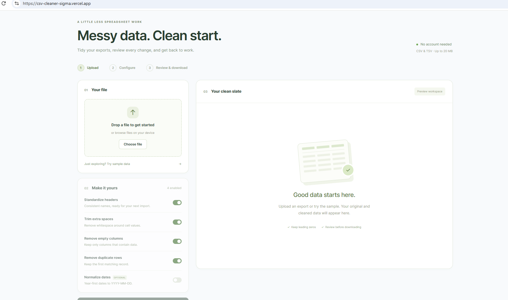

# CSV Cleaner

**Messy data. Clean start.**

A focused web app for cleaning CSV and TSV exports, reviewing the changes, and downloading the result.

**[Open the live app](https://csv.splashmaxcreative.com/)** · [Splashmax Creative](https://splashmaxcreative.com/) · [Reuse permissions](LICENSE)



## Workspace



## Features

- Upload UTF-8 CSV and TSV files up to 20 MB.
- Detect comma, semicolon and tab separators, with a manual override.
- Choose header standardisation, whitespace trimming, empty-column removal and duplicate removal independently.
- Match duplicates using selected columns, or compare complete rows.
- Preserve leading zeros, blank cells and literal values such as `NA`.
- Optionally convert unambiguous year-first dates; preserve other values.
- Compare the first ten original and cleaned rows, then download every cleaned row.
- Save up to ten named cleaning presets in your browser.
- Use a responsive workspace with searchable column selection.

## How to use it

1. Upload a file, or try the built-in synthetic sample.
2. Confirm the separator and choose the operations you want.
3. Optionally select duplicate-matching columns or apply a saved preset.
4. Select **Clean & preview** and compare the original and cleaned samples.
5. Download the cleaned CSV.

Downloads always use commas, even when the input uses semicolons or tabs.

## Data handling and limitations

**Processing happens on the API server, not entirely in your browser.** Uploaded contents are held in memory; the application does not intentionally persist uploaded files. Hosting infrastructure may maintain request metadata independently.

Only preset settings and column names are stored in browser local storage. Uploaded files and row values are not stored there. Clearing browser storage removes saved presets; presets do not sync between devices.

- Excel workbooks, PDFs and legacy encodings are not supported.
- Date conversion is off by default. It accepts `YYYY/MM/DD` and `YYYY-MM-DD`; ambiguous dates and timestamps are preserved.
- Duplicates retain the first matching row. Selecting key columns can remove rows whose other values differ.
- This is a generic cleaner, not a platform-specific import validator. Header changes may make an export incompatible with Shopify or another destination. Keep originals and review all options before re-importing.
- The preview shows ten rows, not a full spreadsheet editor.

## Stack and structure

| Location | Purpose |
| --- | --- |
| `client/` | React 18, Vite and Tailwind frontend |
| `client/src/presets.js` | Validated browser-local preset storage |
| `server/` | Flask, pandas and Flask-CORS API |
| `server/test_app.py` | API regression tests |
| `deploy/` | Reverse-proxy configuration |
| `docker-compose.yml` | Local frontend/API containers |

## Local development

These instructions are for the owner and authorised developers. They are not a grant of reuse rights; see [LICENSE](LICENSE).

Prerequisites: Git, Node.js 20+ with npm, and Python 3.10+ with pip.

```sh
git clone https://github.com/OluochBen/csv-cleaner.git
cd csv-cleaner
```

### API — terminal one

```sh
cd server
python -m venv .venv
source .venv/bin/activate
# Windows PowerShell: .venv\Scripts\Activate.ps1
pip install -r requirements.txt
python app.py
```

The API listens on `http://localhost:5000`. Check `GET /api/health`.

### Frontend — terminal two

```sh
cd client
npm ci
npm run dev
```

Open the URL printed by Vite, normally `http://localhost:5173`. Its development proxy forwards `/api/*` to Flask.

## Configuration and deployment

For a separately hosted API, set a **public base URL** in `client/.env.local` before building:

```dotenv
VITE_API_URL=https://your-api.example.com
```

`VITE_*` variables are included in the browser bundle. **Never put credentials or private tokens in them.** The URL should not include `/api/clean-csv`.

Leave this variable unset when your host routes same-origin `/api/*` requests to the API.

```sh
cd client
npm ci
npm run build
```

Serve `client/dist/` as the frontend and deploy the Flask API separately, or use the supplied Docker configuration. Deploy compatible client and API versions together when adding response fields or endpoints.

### Docker

From the repository root:

```sh
docker compose up --build
```

Frontend: `http://localhost:4173` · API: `http://localhost:5000`

The frontend container proxies API requests to the backend container.

## Checks

With the API virtual environment activated, run from the repository root:

```sh
python -m unittest discover -s server -v
node --test client/src/presets.test.js
npm --prefix client run build
```

## API

- `GET /api/health` — health response.
- `POST /api/clean-csv` — multipart form with a `file` field.

| Field | Default | Meaning |
| --- | --- | --- |
| `delimiter` | `auto` | `auto`, comma, semicolon or a literal tab |
| `clean_headers` | `true` | Use unique normalised headers |
| `trim_cells` | `true` | Trim surrounding whitespace |
| `drop_empty_columns` | `true` | Remove blank columns |
| `remove_duplicates` | `true` | Keep first matching row |
| `dedupe_cols` | All columns | Comma-separated normalised column keys |
| `normalize_dates` | `false` | Conservative year-first date conversion |
| `preview` | `false` | Return JSON with samples, stats and the complete cleaned CSV |

Without `preview=true`, the response is a CSV attachment with summary headers.

## Security and repository hygiene

Do not commit real exports, credentials, customer lists or database dumps. Use synthetic examples in tests. Review the staged diff before publishing changes.

The [repository exposure review](docs/security-review.md) records the scope and limits of the 19 October 2026 code/history audit. It is not a certification or a guarantee that every possible secret has been detected.

## Rights and attribution

Copyright © 2025–2026 Benard Oluoch. **All rights reserved for original project code and assets.**

This is a public-source portfolio project, not an open-source release. Reuse requires permission except where applicable law, GitHub's terms, or a third-party licence permits otherwise. Dependency licences remain in force.

For permission or commercial work: [ben@splashmaxcreative.com](mailto:ben@splashmaxcreative.com).
